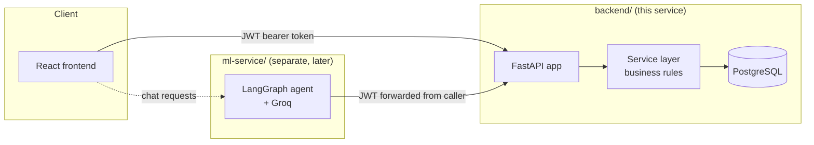
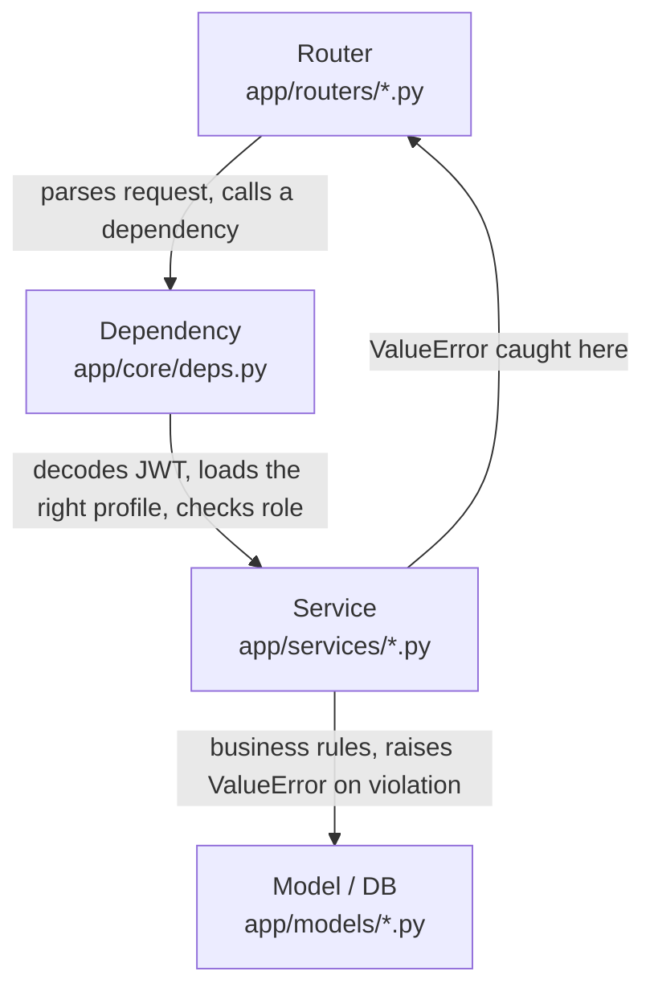
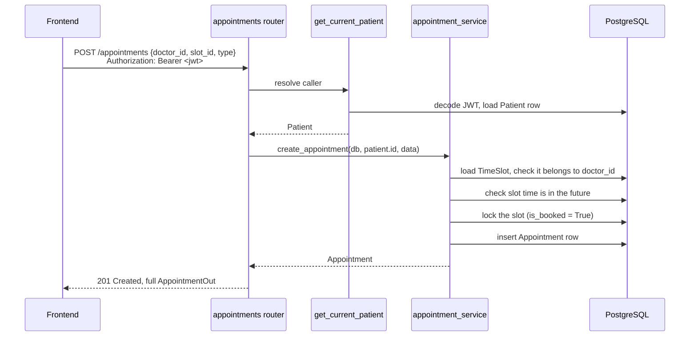
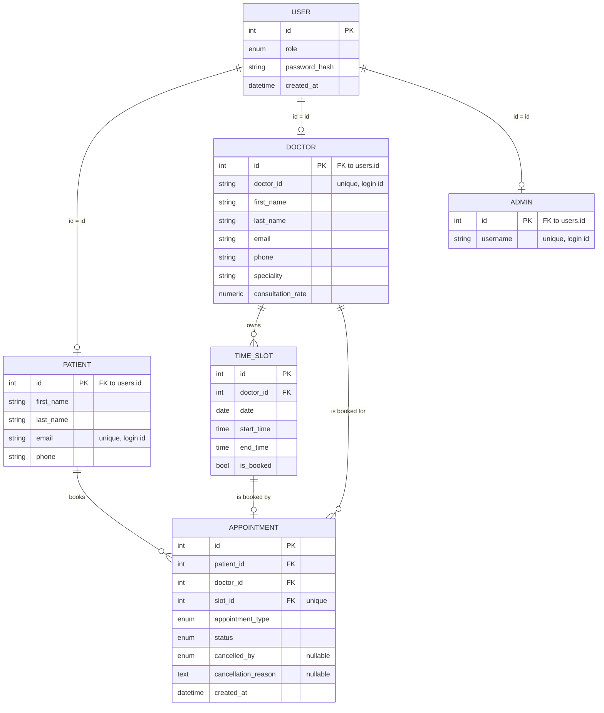

# Med-Log Backend

FastAPI + SQLAlchemy + PostgreSQL backend for the Med-Log appointment management system. Handles authentication for three roles (patient, doctor, admin), doctor time-slot management, and full appointment CRUD with search/filter — including the business rule that no appointment can be cancelled or reassigned within one hour of its scheduled time.

This document explains how the pieces fit together and why they're structured the way they are. For the step-by-step "how do I run this" instructions, see the setup section near the end.

## Architecture overview

The backend is a single FastAPI service sitting in front of PostgreSQL. A separate `ml-service` (LangGraph + Groq, built later) will call this backend's REST API using the caller's own JWT — it never touches the database directly. That boundary is deliberate: this backend is the single place authorization and business rules are enforced, so even a successful prompt-injection attack against the chatbot can't make it return data the backend wouldn't otherwise authorize.



## Request flow: a request through the layers

Every request passes through the same four layers, in the same order, regardless of which endpoint it hits:



- **Routers** parse the HTTP request (FastAPI + Pydantic already validated the body/query by this point) and call exactly one service function.
- **Dependencies** (`get_current_patient`, `get_current_doctor`, `get_current_admin`) turn a Bearer token into the actual profile row the request is allowed to act as — this is where role-checking happens, once, instead of being re-implemented in every route.
- **Services** hold every business rule: slot booking, the 1-hour lock, who can cancel what. They know nothing about HTTP — they raise a plain `ValueError`, which the router that called them turns into the right status code.
- **Models** are just SQLAlchemy table definitions. No logic lives here beyond column types and relationships.

Concretely, here's what happens when a patient books an appointment:



## Database schema



**Why one `User` table plus three profile tables, instead of three independent tables?** Login, password, and role are identical concepts across all three account types — pulling them into one `User` table means `core/security.py` and `core/deps.py` only ever deal with one shape of "who is this." Each profile table (`Patient`/`Doctor`/`Admin`) then adds only the fields specific to that role, sharing its primary key with the `User` row it belongs to (`Patient.id == User.id`, not an independent auto-increment). The tradeoff: every query that needs a patient's role has to join through `User` — acceptable here since nothing in this app queries at a scale where that join matters.

**Why does `Doctor` have both `id` and `doctor_id`?** `id` is the internal numeric primary key every foreign key in the app points to. `doctor_id` (e.g. `"DOC001"`) is a separate, human-facing string — it's what a doctor actually types in at login, and the only thing shown to a patient choosing a doctor. Keeping them separate means the login identifier can look however it needs to without constraining how the database joins work internally.

## Key architecture decisions

| Decision | Why |
|---|---|
| **Layered structure**: `models` → `schemas` → `services` → `routers` | Each layer has exactly one job. A router never touches the database directly; a service never knows about HTTP status codes. Business logic (the 1-hour lock, slot booking) lives in exactly one place — `services/` — instead of being duplicated across endpoints or leaking into the frontend. |
| **One `/auth/login` endpoint for all three roles**, with an explicit `role` field in the request | A patient logs in with an email, a doctor with a `doctor_id` string, an admin with a username. Without `role`, the backend would have to guess which table to check — or worse, check all three and risk two different roles having identifiers that happen to collide. |
| **Soft-delete on patient cancel** (`DELETE /appointments/{id}` sets `status=cancelled`, doesn't remove the row) | The appointment still needs to show up in the patient's history after cancelling. A hard delete would make a cancelled appointment indistinguishable from one that never existed. |
| **The 1-hour lock lives in `appointment_service._assert_outside_lock_window`, not the frontend** | A frontend check is cosmetic — anyone calling the API directly (or a buggy frontend build) could bypass it. Enforcing it server-side, in one function every cancel/reschedule path calls, means it's actually a guarantee, not a suggestion. |
| **Slot times are stored and compared as naive local datetimes, not UTC** | The doctor who creates a slot picks a wall-clock time with no timezone attached, and the frontend will never send one either. An earlier draft of `_slot_datetime()` tagged this local value as UTC while comparing against real UTC "now" — on a UTC+5:30 machine, that silently disabled the 1-hour lock, since a slot 30 minutes away read as nearly 6 hours away. Caught by an integration test that deliberately tries to cancel a near-term appointment. Fixed by keeping both sides of every time comparison naive and local. If this app ever needs to span multiple timezones, this is the first thing that has to change. |
| **No Alembic — tables are created with `Base.metadata.create_all()` on startup** | Faster to set up for a project this size, at the cost of no migration history. Changing a model after tables already exist means dropping and recreating the database by hand. Worth adding Alembic if this grows past a single-developer assessment project. |
| **Admins and doctors are never self-signed-up** | Only `PatientSignupRequest` exists as a public signup form. Doctors are created via the admin-only `POST /admin/doctors`; the one admin account is created by `app/seed.py`. This matches the brief directly: "no doctor signup page, this will be done via admin." |
| **`bcrypt` pinned to `4.0.1` in `requirements.txt`** | `passlib==1.7.4` expects `bcrypt` to expose a `__about__.__version__` attribute that `bcrypt>=4.1` removed, which otherwise crashes every password hash with a confusing `password cannot be longer than 72 bytes` error unrelated to the actual password. Pinning avoids the whole class of bug on a fresh install. |

## API surface

| Method & path | Who | What it does |
|---|---|---|
| `POST /auth/signup` | public | Patient self-signup |
| `POST /auth/login` | public | Login for all three roles (`role` field picks the table) |
| `GET /patients/me` / `PATCH /patients/me` | patient | View/edit own profile (name, phone, password) |
| `GET /doctors` | public | Doctor directory (for the booking dropdown) |
| `GET /doctors/{id}/slots` | public | A doctor's open slots, optionally filtered by date |
| `GET /doctors/me` / `PATCH /doctors/me` | doctor | View/edit own profile (name + password only) |
| `POST /slots` | doctor | Add a new bookable slot (rejects overlaps) |
| `POST /appointments` | patient | Book an appointment |
| `GET /appointments/me` | patient | List own appointments, filterable by status/type/doctor/date range |
| `PATCH /appointments/{id}` | patient | Reschedule / change doctor (subject to the 1-hour lock) |
| `DELETE /appointments/{id}` | patient | Cancel own appointment (subject to the 1-hour lock) |
| `GET /appointments/doctor/mine` | doctor | List own appointments, same filters as above |
| `POST /appointments/{id}/cancel` | doctor | Cancel with a mandatory 200+ character reason (subject to the 1-hour lock) |
| `POST /appointments/{id}/resolve` | doctor | Mark a past appointment Completed / No-show / Needs Rescheduling |
| `POST /admin/doctors` | admin | Seed a new doctor account |
| `GET /admin/users` | admin | List users, filterable by role |
| `GET /admin/health` | admin | Confirm the API and database are both reachable |

Full request/response schemas are auto-generated at `/docs` (Swagger UI) once the server is running.

## Folder structure

```
backend/
├── app/
│   ├── core/       # settings, password hashing, JWT, request-auth dependencies
│   ├── db/         # SQLAlchemy base class + engine/session setup
│   ├── models/     # table definitions — no logic beyond columns and relationships
│   ├── schemas/     # Pydantic request/response shapes + field validation
│   ├── services/    # business rules — the only layer that writes to the DB
│   ├── routers/     # HTTP layer — thin, calls one service function per endpoint
│   ├── main.py      # app entry point, wires everything together
│   └── seed.py      # one-off script: creates the admin + 2 sample doctors
└── tests/
    ├── conftest.py              # in-memory SQLite fixture
    └── test_appointment_rules.py # double-booking + 1-hour lock tests
```

## Running it

```powershell
# from inside backend/, with a Python 3.12 venv already activated
pip install -r requirements.txt
Copy-Item .env.example .env   # then edit DATABASE_URL / JWT_SECRET_KEY
uvicorn app.main:app --reload --port 8000
python -m app.seed            # in a second terminal — creates admin + sample doctors
```

Without a `.env` file, the app falls back to a local SQLite file and a default dev secret — enough to boot and poke around, but use the real `.env` values (Postgres, a real secret) for anything that matters.

## Testing

```powershell
pytest -v
```

Runs against an in-memory SQLite database (`tests/conftest.py`) — never touches the real Postgres data. Covers the two rules most likely to only *look* correct from the UI: that a slot can't be double-booked, and that an appointment inside the 1-hour window can't be cancelled.

Beyond the unit tests, this backend has also been exercised with a full integration pass against a live server covering all three roles' signup/login, admin doctor-seeding, slot creation and overlap rejection, booking, double-booking rejection, filtering, reschedule, both cancel paths, the resolve flow, and role-boundary enforcement (a patient token can't hit a doctor-only route, etc.) — all passing.

## Known limitations

- No Alembic migrations — see the architecture decisions table above.
- No refresh tokens — a JWT is valid for `ACCESS_TOKEN_EXPIRE_MINUTES` (default 120) and then just expires; there's no silent-refresh flow.
- No rate limiting on `/auth/login` or `/auth/signup`.
- Timezones are deliberately naive/local throughout — see the architecture decisions table. Fine for a single-location clinic; would need rework for a multi-timezone deployment.
